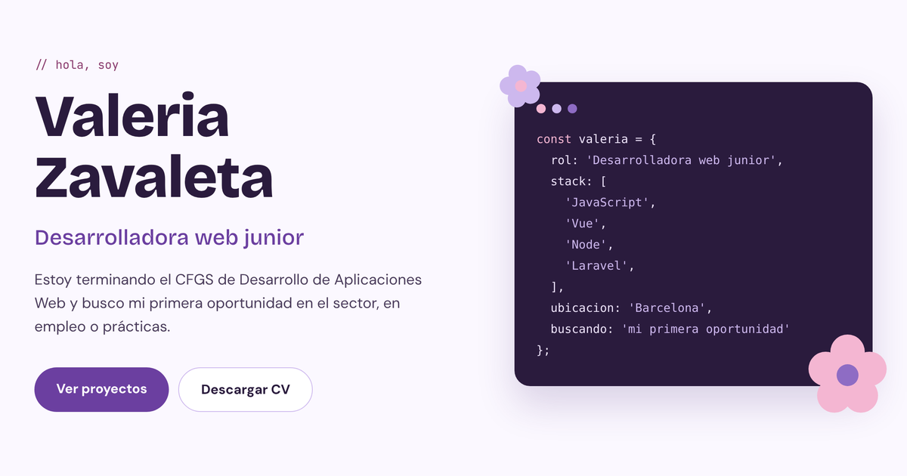

# Portfolio · Valeria Zavaleta

Mi web personal como desarrolladora web junior: quién soy, los proyectos que he construido durante el CFGS de Desarrollo de Aplicaciones Web y cómo contactarme.

**🔗 Web:** [valeria-zavaleta.vercel.app](https://valeria-zavaleta.vercel.app)



## Stack

- **Vue 3** con `<script setup>` (Composition API)
- **Vite** como entorno de desarrollo y build
- **CSS propio** con variables (sin frameworks de estilos)
- **Vercel** para el despliegue: cada push a `main` se publica automáticamente

## Qué incluye

- **Hero** con una tarjeta de código y flores SVG hechas como componente (`RoundFlower.vue`)
- **Proyectos** con un slider de capturas que cambia solo, se pausa al pasar el ratón y respeta `prefers-reduced-motion`
- **Sobre mí, Stack y Contacto**
- **Diseño responsive**, pensado también para móvil
- **Metadatos Open Graph** para que el enlace se vea con imagen al compartirlo en LinkedIn o WhatsApp

## Estructura

```
src/
├── components/   # Secciones y componentes reutilizables (NavBar, HeroSection, ProjectCard…)
├── data/         # Contenido en archivos de datos: projects.js y stack.js
├── style.css     # Variables de color, tipografías y estilos globales
└── main.js
public/
├── projects/     # Capturas de los proyectos (WebP)
└── ValeriaZavaleta_CV.pdf
```

El contenido (proyectos y tecnologías) vive en `src/data/`, separado de los componentes, así que para añadir un proyecto basta con añadir un objeto a `projects.js`.

## Ejecutar en local

```bash
npm install
npm run dev
```

Para generar la versión de producción:

```bash
npm run build
npm run preview
```

## Contacto

- LinkedIn: [valeria-zavaleta-vasquez](https://www.linkedin.com/in/valeria-zavaleta-vasquez)
- GitHub: [valeriazv99](https://github.com/valeriazv99)
- Email: valeriazv99@gmail.com
